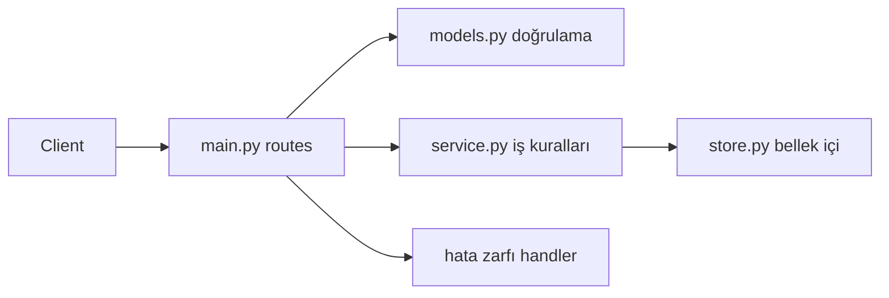

# Limits & Statements Servisi - Uygulama Planı

> **Durum: ONAY BEKLİYOR. Kullanıcı onaylayana kadar hiçbir kod yazılmaz.**
> Kaynaklar (tek doğru kaynak): [`docs/PRD-limits.md`](docs/PRD-limits.md), [`docs/API-SPEC-limits.yaml`](docs/API-SPEC-limits.yaml). Bağlayıcı standart: [`docs/ENGINEERING-HANDBOOK.md`](docs/ENGINEERING-HANDBOOK.md). Görev kartı: [`missions/M1-dokumandan-koda.md`](missions/M1-dokumandan-koda.md).

## Genel Bakış

**Hedef:** Canlıya çıkmadan önce müşteri bazlı günlük + işlem başına transfer limiti uygulayan ve onaylanmış işlemlerin dökümünü (statement) veren, küçük ve bağımsız bir FastAPI servisi.

**Kapsam:** `services/limits/` (yeni paket), `tests/test_limits_*.py` (yeni), coverage ayarı (`ci.yml`, `.coveragerc`).

**Kısıtlar (PRD + kullanıcı):**
- `services/core/` değiştirilmez ve **içe aktarılmaz** (ne kod ne test tarafında).
- Bellek içi depolama; tek para birimi (TRY); kimlik doğrulama yok.
- Yeni bağımlılık eklenmez (`requirements.txt`: fastapi, uvicorn, pydantic yeterli).
- Uygulama `services/limits/main.py` içinde `app` adıyla sunulur.

**Onaylanan tasarım kararları:**
1. Test: API seviyesinde (`TestClient`), `store.reset()` autouse fixture'ı, %85 kapsam `services/limits` için de korunur, CI coverage komutu genişletilir.
2. `customer_id` yalnızca HTTP katmanında doğrulanır (path regex `^C[0-9]{6}$`); servis katmanı doğrulanmış girdi varsayar.
3. `from` alanı Python'da ayrılmış sözcük olduğundan alias yaklaşımı (`from_` ↔ `from`).
4. Para: `decimal.Decimal`, `float` yok. Girişte en fazla 2 ondalık (`"1000"`, `"1000.5"`, `"1000.50"` geçerli; `"100.123"` geçersiz). `NaN`/`Infinity`/bilimsel gösterim reddedilir. Çıktı her zaman tam 2 ondalık string.

**Önerilen dosya yapısı (core'daki desenle uyumlu: `main / models / service / store`):**

| Dosya | Sorumluluk |
|---|---|
| `services/limits/__init__.py` | Paket işaretçisi |
| `services/limits/main.py` | `app`, route'lar, hata zarfı handler'ları |
| `services/limits/models.py` | Pydantic istek/yanıt modelleri, tutar/tarih doğrulama, `Money` biçimleme |
| `services/limits/service.py` | İş kuralları (limit set/get, authorize, statement) |
| `services/limits/store.py` | Bellek içi veri + `reset()` (test API'si) |

**Akış:**

## PRD bölüm 4 izlenebilirlik matrisi

| # | Kural | Nerede ele alınır |
|---|---|---|
| 1 | Varsayılan limitler 10000.00 / 5000.00, `source=default` | Alt görev 2 |
| 2 | `per <= daily`, ikisi `> 0` | Alt görev 1 (doğrulama) + 2 |
| 3 | Limitler dahil (`<=`) | Alt görev 3 |
| 4 | Onay: `amount <= per` ve `kullanım + amount <= daily` | Alt görev 3 |
| 5 | İkisi de aşılırsa `PER_TRANSFER_LIMIT_EXCEEDED` öncelikli | Alt görev 3 |
| 6 | Onaylanan kullanıma + statement'a yazılır; red hiçbir yere yazılmaz | Alt görev 3 |
| 7 | Kullanım günler arası bağımsız (`occurred_on` anahtarı) | Alt görev 3 |
| 8 | Limit değişikliği geçmiş kullanımı silmez | Alt görev 2 + 3 (kullanım limitten ayrı tutulur) |
| 9 | Statement: uçlar dahil, `occurred_on` artan, aynı gün onay sırası | Alt görev 4 |
| 10 | `from > to` geçersiz; işlemsiz müşteri için boş statement | Alt görev 4 |

PRD bölüm 5 (biçim): string para + 2 ondalık, `YYYY-MM-DD`, tek hata zarfı, 422 `VALIDATION_ERROR`, red = HTTP 200 + `allowed:false` → Alt görev 1.

---

## Alt Görevler

### Alt Görev 1 - İskelet, modeller, para/tarih doğrulama ve hata zarfı

- **Intent:** Diğer tüm alt görevlerin dayandığı zemini kurmak: paket, `app`, doğrulama ve tek tip hata biçimi.
- **Expected Outcomes:**
  - `from services.limits.main import app` çalışır; `services.core` hiçbir yerde import edilmez.
  - Her geçersiz girdi (path, body, query, eksik alan, bozuk JSON, bozuk tarih) HTTP 422 + `{"error":{"code":"VALIDATION_ERROR","message":"..."}}` döner; `{"detail": ...}` asla dönmez.
  - Para ayrıştırma/biçimleme yardımcıları tek yerde: `"1000"`→`1000.00`, `"1000.5"`→`1000.50`, `"100.123"`, `"abc"`, `""`, `"0"`, `"-1"`, `NaN`, `Infinity`, `1e3` reddedilir.
- **Todo List:**
  1. `services/limits/__init__.py`, `store.py` (boş yapılar + `reset()`), `models.py`, `service.py`, `main.py` dosyalarını oluştur.
  2. Tutar tipi: string girişi `Decimal`'e çeviren, en fazla 2 ondalık ve `> 0` kuralını uygulayan doğrulayıcı; çıktı için `quantize(0.01, ROUND_HALF_UP)` + string biçimleyici.
  3. `customer_id` path parametresi için regex `^C[0-9]{6}$` (yalnızca HTTP katmanı).
  4. `RequestValidationError` için özel exception handler: 422 + hata zarfı, okunabilir `message` (boş olmamalı).
  5. Beklenmeyen hatalar için `INTERNAL_ERROR` handler'ı (sabit mesaj, istemciye ayrıntı sızdırma; sunucuda `logging`, PII yok, `print` yok).
  6. Tarih alanları gerçek tarih doğrulaması (`2025-13-45` reddedilir).
- **Relevant Context:** Handbook bölüm 1-3 (para, hata zarfı, loglama); core'daki `services/core/main.py` yalnızca **desen referansı olarak** okunur, import edilmez. Core'un `float` kullanan modelleri **kopyalanmaz** (handbook ile çelişir).
- **Status:** `[ ] pending`

### Alt Görev 2 - Limit tanımlama ve sorgulama (`PUT/GET /limits/{customer_id}`)

- **Intent:** PRD kural 1, 2, 8: limitlerin saklanması, varsayılanlar ve tutarlılık kontrolü.
- **Expected Outcomes:**
  - `GET` tanımsız müşteri için `10000.00 / 5000.00`, `source: "default"`.
  - `PUT` geçerli girdiyle kaydeder (`source: "custom"`), `GET` aynı değerleri 2 ondalıkla döner (`"5000"`→`"5000.00"`, `"2000.5"`→`"2000.50"`).
  - `per > daily`, `<= 0`, 3 ondalık, `abc`, boş string, eksik alan → 422 zarf.
  - Limit güncellemesi kullanım verisine dokunmaz.
- **Todo List:**
  1. Store'da limitler ve kullanım **ayrı** yapılarda tutulur (kural 8'in yapısal güvencesi).
  2. `LimitsInput` modeli: iki alan zorunlu, `per_transfer_limit <= daily_limit` çapraz doğrulaması.
  3. Servis fonksiyonları: `set_limits`, `get_limits` (varsayılan döndürme, kaydetmeden).
  4. `Limits` yanıt modeli: `customer_id`, `daily_limit`, `per_transfer_limit`, `source`.
  5. Route'ları `main.py`'ye bağla.
- **Relevant Context:** `API-SPEC-limits.yaml` `LimitsInput`, `Limits`; PRD bölüm 4 kural 1-2, 8.
- **Status:** `[ ] pending`

### Alt Görev 3 - Yetkilendirme (`POST /limits/{customer_id}/authorize`)

- **Intent:** Servisin çekirdek iş kuralı: limit kararı, kullanım kaydı ve statement kaydı.
- **Expected Outcomes:** PRD bölüm 7 örnek senaryosu satır satır tutar:

  | Sıra | Tarih | Tutar | Sonuç | Kalan günlük |
  |---|---|---|---|---|
  | 1 | 2025-03-14 | 1500.00 | onay | 3500.00 |
  | 2 | 2025-03-14 | 2500.00 | red PER_TRANSFER | 3500.00 |
  | 3 | 2025-03-14 | 2000.00 | onay | 1500.00 |
  | 4 | 2025-03-14 | 1600.00 | red DAILY | 1500.00 |
  | 5 | 2025-03-15 | 1600.00 | onay | 3400.00 |

  - Red HTTP 200 + `allowed:false` + `reason`; onayda `reason: null`.
  - Tam limite eşit tutar onaylanır; ikisi de aşılırsa `PER_TRANSFER_LIMIT_EXCEEDED`.
  - Red kullanıma ve statement'a yazılmaz; kullanım günlere göre bağımsız.
  - `0.10 x 3` ile `0.30` limit tam eşleşir (float hatası yok).
  - Geçersiz tutar/tarih → 422 zarf. `description` opsiyonel/nullable.
- **Todo List:**
  1. `AuthorizeInput` (`amount`, `occurred_on`, `description?`) ve `Decision` (`customer_id`, `allowed`, `reason`, `remaining_daily`) modelleri.
  2. Karar sırası: önce `amount <= per_transfer_limit` (aksi `PER_TRANSFER_LIMIT_EXCEEDED`), sonra `günlük_kullanım + amount <= daily_limit` (aksi `DAILY_LIMIT_EXCEEDED`).
  3. `remaining_daily` = karardan **sonra** `daily_limit - o günün kullanımı` (redde değişmeyen değer).
  4. Onayda kullanım toplamı ve onay sırasını koruyan kayıt listesi güncellenir; kontrol + yazma tek senkron adımda yapılır (okuma-yazma yarışı olmasın; `def` route'ları iş parçacığı havuzunda çalışır, gerekirse `threading.Lock`).
  5. Route'u `main.py`'ye bağla; red durumunda hata değil 200 dön.
- **Relevant Context:** PRD kural 3-7, bölüm 7; `API-SPEC-limits.yaml` `AuthorizeInput`, `Decision`.
- **Status:** `[ ] pending`

### Alt Görev 4 - Statement (`GET /statements/{customer_id}?from=&to=`)

- **Intent:** PRD kural 9-10: onaylanmış işlemlerin tarih aralığında dökümü.
- **Expected Outcomes:**
  - Yalnızca onaylananlar; `from` ve `to` dahil; `occurred_on` artan, aynı gün onay sırası (kararlı sıralama).
  - `entries[]` içinde `occurred_on`, `amount` (2 ondalık), `description` (null olabilir); `total` doğru toplam (`Decimal`), `from`/`to` yanıtta aynen yer alır (JSON anahtarı `from`).
  - İşlemsiz müşteri: `entries: []`, `total: "0.00"`, HTTP 200.
  - `from > to`, eksik veya bozuk tarih → 422 zarf.
- **Todo List:**
  1. `from` için alias: model alanı `from_`, JSON/query adı `from`; yanıtta da `from` serileştirilir (`by_alias`).
  2. Servis: kayıtları aralığa göre filtrele, `occurred_on` ile **kararlı** sırala, toplamı hesapla.
  3. `from > to` doğrulaması (422).
  4. Route'u bağla; eksik query parametresi de hata zarfına düşmeli.
- **Relevant Context:** PRD kural 9-10; `API-SPEC-limits.yaml` `Statement`.
- **Status:** `[ ] pending`

### Alt Görev 5 - Testler ve CI kapsam ayarı

- **Intent:** Handbook bölüm 4 standardı ve onaylanan %85 hedefi; doğrulamanın otomatikleştirilmesi.
- **Expected Outcomes:**
  - `tests/test_limits_*.py`: yalnızca `TestClient` ile endpoint seviyesinde; dosya başına `@pytest.fixture(autouse=True)` ile `store.reset()`; `test_<davranış>_<koşul>` isimlendirme; AAA ayrımı.
  - Her özellik için en az bir mutlu yol + bir negatif + bir sınır değeri testi; PRD bölüm 7 senaryosu uçtan uca testte.
  - `services/limits` satır kapsamı >= %85 (branch açık).
  - CI'da `services/limits` için **ayrı bir coverage adımı** vardır; mevcut core adımı olduğu gibi kalır.
  - `python3 verify/run.py m1` → 35 kontrolün tamamı PASS.
- **Todo List:**
  1. Test dosyaları: limitler, authorize (sınırlar, öncelik, günler arası, limit değişimi, ondalık/float), statement (aralık uçları, sıra, boş, `from > to`), hata zarfı (422 biçimi, bozuk `customer_id`).
  2. [`.github/workflows/ci.yml`](.github/workflows/ci.yml): mevcut core adımı (satır 18-19, `--cov=services/core`) **değiştirilmez**. Hemen ardına ayrı bir adım eklenir: `pytest tests/test_limits_*.py --cov=services/limits --cov-branch --cov-fail-under=85` (adım adı: "Run limits tests with coverage"). Komut satırındaki `--cov=`, [`.coveragerc`](.coveragerc)'deki `source = services/core` ayarını geçersiz kılar; `.coveragerc`'ye dokunulmaz (core ölçümü etkilenmesin).
  3. Lokal çalıştırma: yukarıdaki limits komutu, ardından `python3 verify/run.py m1`.
  4. Semgrep kuralları (`security/semgrep-rules.yml`) açısından: koda gömülü sır, shell çağrısı yok - kontrol et.
- **Relevant Context:** [`pytest.ini`](pytest.ini) (`pythonpath = .`, `testpaths = tests`), mevcut örnek: [`tests/test_health.py`](tests/test_health.py); [`verify/test_m1_limits.py`](verify/test_m1_limits.py) kabul kontrolleri (35 kontrol).
- **Status:** `[ ] pending`

---

## Riskler ve Açık Noktalar

- **Global kapsam eşiği:** `--cov-fail-under=85` birleşik ölçüm yapar. `services/core` için şu an yalnızca `test_health.py` var; core kapsamı düşükse, `services/limits` eklenince CI'daki birleşik sonuç eşiğin altında kalabilir. Bu durum alt görev 5'te ölçülür; gerekirse `services/limits` için **ayrı bir CI adımı** önerilir (core'a dokunmadan). Karar kullanıcıya bırakılır.
- Eşzamanlılık: bellek içi store tek süreç içindir; kilit yalnızca tek süreç içi tutarlılığı sağlar (kalıcılık ve çoklu süreç kapsam dışı).
- Statement'ta aynı gün onay sırası, kayıt listesinde ekleme sırası + kararlı sıralama ile korunur.
